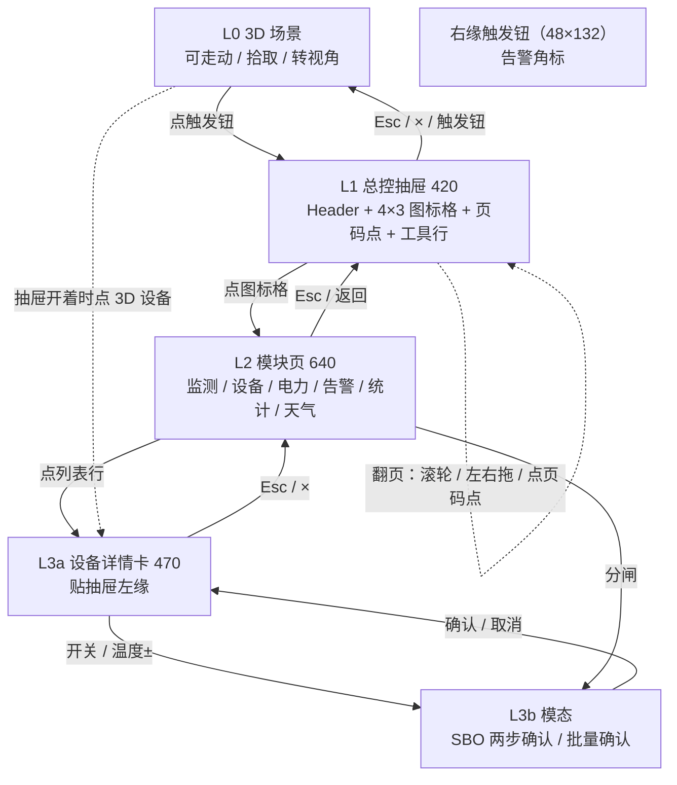
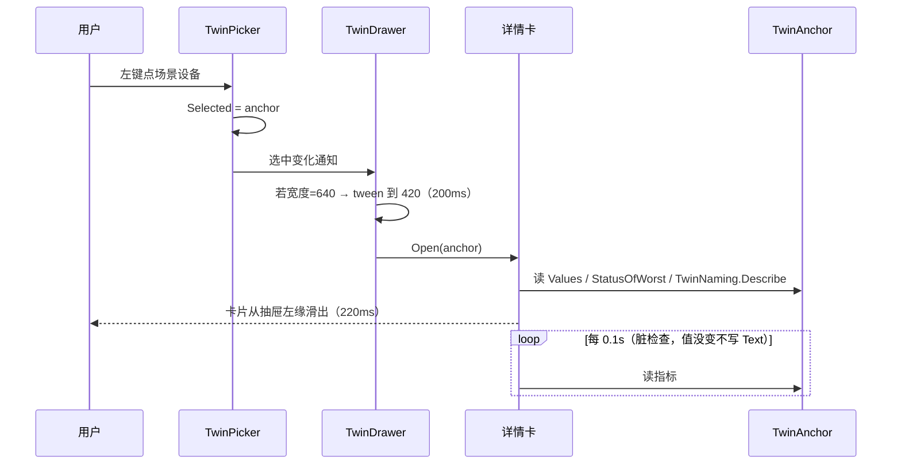
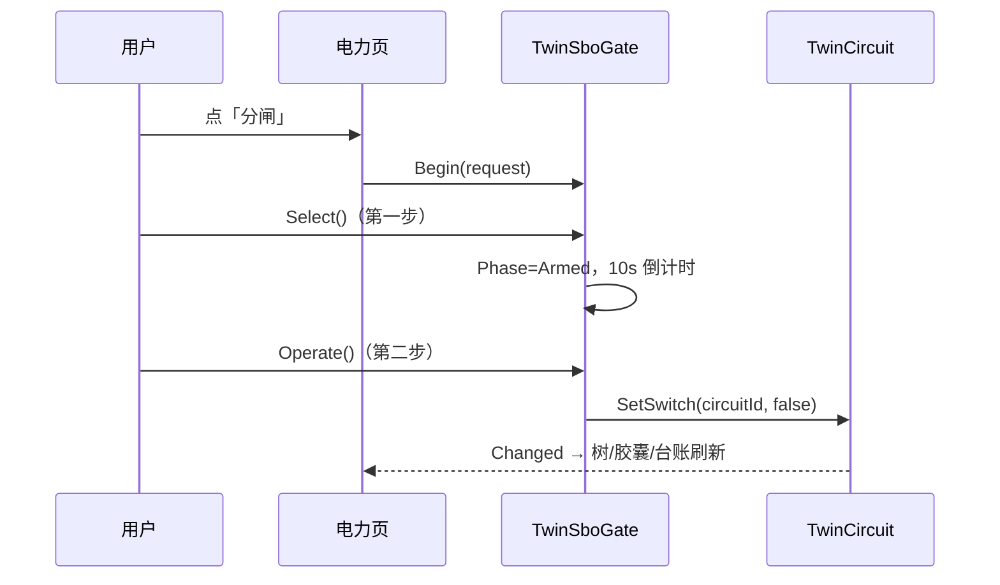

<!--
  本文档是 P28「校园统一管理系统 · 收纳式总控面板」的实施方案。
  交付内容对应需求 6 条：调研分析报告（第一部分）、交互流程图（§2.5/2.6/4.3）、
  UI 设计规范（第三部分）、功能模块开发排期（第八部分）、技术实现路径（第七部分）。
  实施时以本文档为准；如与代码冲突，以代码实际行为为准并回写本文档。
-->

# 校园统一管理系统 · 收纳式总控面板 · 落地方案（P28）

> 工程：`E:/Unity Projects/School-pro`（Unity 2022.3 内置管线，UGUI 纯代码，零美术资源）
> 现状问题：面板分散（F4/G/T/H 四个窗口可同时开、互相压）、风格 12 处不统一、图表只有一条 60s 折线、无统一导航。
> 目标：一个侧边呼出的收纳式总控面板 + 5 个功能模块 + 统一科技风 + 统一编号。

---

# 第一部分 · 调研分析报告

## 1.1 调研对象（10 个案例）

| # | 案例 | 类型 | 可借鉴的核心点 |
|---|---|---|---|
| 1 | **51WORLD / 51Aes 智慧校园**（中科大智慧驾驶舱、虎门外语学校、墨尔本大学新校区） | 数字孪生校园 | 「全球—全国—建筑—室内」**多尺度层级下钻**；教学/安防/能耗/资产多业务在同一底座上切换；把平面管理系统可视化 |
| 2 | **Hightopo 智慧储能园区一体化管控平台** | 工业级管控面板 | **点设备 → 弹 2D 面板**（BMS/PCS/EMS 三级数据）；**分级告警**（声光/短信/弹窗）；设备健康度**色彩进度条**；告警列表区分**已处理/未处理**；趋势 + 柱状图表 |
| 3 | **Hightopo 智慧火电厂 / 选煤厂** | 工业数字孪生 | 2D/3D 协同、按业务视角切换布局；同一设备支持"外部视角"与"内部参数"两级 |
| 4 | **Siemens Desigo CC** | 楼宇管理平台（IBMS） | **跨系统联动场景**（"会议模式"一键联动灯光/窗帘/空调/投影）；左侧管理站**层级树** + 右侧工作区 |
| 5 | **Schneider EcoStruxure Building Operation** | 楼宇运营系统 | 单视图聚合多系统；以"设备—空间—系统"三个维度做导航 |
| 6 | **Johnson Controls OpenBlue / Honeywell Forge** | 建筑数字孪生 | 设备台账 + 能效 + 告警三合一；强调"资产编号"作为主键贯穿所有模块 |
| 7 | **阿里云 DataV / 腾讯 RayData** | 大屏可视化 | 栅格化卡片布局、图表组件规范、深色大屏的可读性约束 |
| 8 | **NVIDIA Omniverse / Unity Reflect** | 3D 协同平台 | 3D 场景与数据面板**双向联动**（点模型→面板，点面板→模型定位） |
| 9 | **《异环》(NTE) 手机式收纳面板**（用户提供参考图） | 游戏 UI | **单容器多页**：4 列图标网格 + 底部页码点 + 底部工具行；侧边滑出；顶部状态摘要条 |
| 10 | **《移动应用 UI 设计模式》侧边抽屉 / 转盘菜单** | 通用交互模式 | 侧边抽屉适合"收纳较多入口"，但**高频任务不宜只藏在侧边** → 需保留常驻快捷入口 |

## 1.2 共性模式提炼（6 条，直接决定本方案）

1. **单容器 + 内部页栈** ＞ 多窗口并列。案例 1/2/4/9 都是"一个主容器 + 层级下钻"，没有一个用"多个浮窗互相压"。
2. **渐进披露**：总控只放"入口"，细节在二级/三级。Hightopo 是"点设备 → 弹面板"，不是"一开始就把所有参数铺满"。
3. **3D 与面板双向联动**是孪生的核心价值（案例 8），面板必须能与场景并置，不能全屏遮挡。
4. **配色 6-3-1**：深色基底 60% + 低饱和科技青蓝主色 30% + 告警橙 10%。"深色是画布，数据与告警才是光源。"
5. **分级告警 + 处理状态**：告警必须能区分"进行中/已恢复"，并能一路追到单台设备。
6. **编号是主键**：案例 4/5/6 都用设备编号贯穿"台账—控制—告警—报表"，编号一变全链路断。

## 1.3 技术可行性验证（对本项目的结论）

| 需要的能力 | 现状 | 结论 |
|---|---|---|
| 侧边抽屉 + 页栈 + 滑入动画 | UGUI 有，`TwinRoundedRect` 可画容器，`Time.unscaledTime` 驱动 tween | ✅ 可行，纯代码 |
| 图标网格 + 页码点 + 翻页 | 同上 | ✅ 可行 |
| 科技风视觉（渐变/描边/发光） | `TwinRoundedRect` 已支持渐变 + 描边；`TwinSparkline` 证明可手写 mesh | ✅ 可行；**发光需用双层描边模拟**（无 shader 资源） |
| 折线图 | `TwinSparkline` 已有 | ✅ 可复用 |
| 柱状/环形/仪表盘 | 无 | ⚠️ 需新写，复用 `TwinRoundedRect.BuildOutline` 的圆弧算法 |
| 设备台账（153 台） | 有 `Registry`，但无 `GetByCategory/GetByFloor` | ⚠️ 需补查询层 + 列表虚拟化 |
| 用电量（kWh） | **只有瞬时 Power，单位还混用 W/kW**，无时序库 | ⚠️ 按决策：Power 积分估算 + 1s 均值聚合 |
| 单设备全链路追溯 | 命令有完整状态机，但 `TwinCommandLog` 容量 500 且**不能按 TwinId 过滤**；告警不落盘 | ⚠️ 需扩日志 + 告警落盘 + 合并时间线 |
| 分级停电 | `TwinCircuit` 三层 20 节点 + `TwinSboGate` 两步确认**已完整** | ✅ 直接复用 |
| 统一编号 | `Zone/Category/Name_NN` 三段，**无楼栋号、无房号** | ⚠️ 需扩展 `TwinSiteLayout` + 新建 `TwinNaming` |

## 1.4 调研发现的可优化补充方向

1. **设备台账要"编号优先"**：案例 6 的经验——列表第一列就是编号，且可搜索/复制，运维才能对上现场。
2. **告警要有"处理状态"**：现在 `TwinAlarmHistory` 只有"进行中/已恢复"，缺"已确认/已忽略"，建议本轮至少加"已确认"。
3. **能耗必须标"估算"**：没有计量表就不能装作有，UI 上所有能耗值前缀 `≈` 并给脚注。
4. **常驻快捷入口**：案例 10 的教训——抽屉不能是唯一入口，需保留"告警角标"在触发钮上，有异常时不用打开就能看到。
5. **3D 联动优先于面板完整**：宁可模块少做一点，也要保证"点场景设备 → 面板同步"这条链不断。

---

# 第二部分 · 交互架构

## 2.1 核心决策：单抽屉 + 内部页栈（三级：总控 → 管理系统 → 模块 Tab）

**一个抽屉容器 `TwinDrawer` + 页栈 `TwinPageStack`**，宽度随层级在 `420 / 640` 之间动画切换。

不做"抽屉套抽屉"的理由：
1. 现状最大的病是"没有任何打开 A 关 B"。双抽屉 = 2 可见性 × 2 焦点 = 4 种组合，仲裁爆炸；单容器只有一个 `TwinUIState.Layer`。
2. 返回语义唯一（栈顶出栈）。双抽屉要额外定义"关外层要不要关内层"。
3. 参考分辨率只有 **1000×720**，420+640 会把 3D 视野压到 50% 以下。
4. 《异环》本身就是单容器多页。

**唯一例外**：设备详情卡（L3a）从抽屉**左缘滑出**，不做页推入 —— 因为详情必须与 3D 场景并置，用户点场景设备时卡片要同步更新；推入会遮住被点的设备，等于抹掉"孪生"卖点。

## 2.2 层级栈

| 层 | 内容 | 宽度 | 进入 | 退出 |
|---|---|---|---|---|
| **L0** | 3D 场景 + **右上角图标钮**（48×48，纯图标无文字） | — | 默认 | — |
| **L1** | **总控面板**：标题 + 3 张概览卡 + 图标格（校园管理系统 / 天气预留）+ 工具行 | 420 | 点右上角钮 | Esc / × |
| **L2** | **校园管理系统面板**：左侧 5 个模块 Tab + 右侧内容区 | 640 | 点「校园管理系统」 | 返回键 / Esc |
| **L3a** | 设备详情卡（贴抽屉左缘滑出） | 470 | 点列表行 / 点 3D 设备 | × / Esc（保留选中） |
| **L3b** | 模态（SBO 确认 / 批量确认 / 导出） | 520×320 居中 | 电力操作、批量操作 | 取消 / Esc |

> **2026-10-29 修正**：初版把 5 个模块直接平铺在 L1，等于跳过了"校园管理系统"这一层，
> 与用户原始诉求（总控 → 点管理系统 → 管理系统面板内展开 5 模块）不符。
> 现在 L1 只放**入口**（校园管理系统 + 天气预留），5 个模块在 L2 用**左侧 Tab** 展开
> —— 这也是 Siemens Desigo CC / EcoStruxure 的做法（左导航 + 右工作区），
> 同一系统内横向切换成本从 2 次点击降到 1 次。

**尺寸自洽**：420 + 470 + 16 = **906 < 1000**，留 94 给场景。因此**详情卡打开时抽屉强制回到 420**。

## 2.3 Esc / 返回 / 关闭 统一规则

| 当前 | Esc | × | 点触发钮 |
|---|---|---|---|
| L3b 模态 | 取消（SBO 走 `Gate.Cancel()`） | 取消 | 无响应 |
| L3a 详情卡 | 关卡片，**保留 3D 选中** | 关卡片 | 关卡片 + 收抽屉 |
| L2 模块页 | 回 L1 | 回 L1 | 收抽屉（清栈） |
| L1 首页 | 收抽屉 | 收抽屉 | 收抽屉 |
| L0 场景 | 清选中（沿用 `TwinPicker`） | — | 打开抽屉 |

**点 3D 空白区不关闭抽屉**（与常规 Side Drawer 相反）：抽屉打开时的主要动作就是"点场景设备 → 详情卡更新"，点外部关闭会让这个动作永远做不成。

## 2.4 动画规格（全部 `Time.unscaledTime`）

| 动作 | 时长 | 缓动 |
|---|---|---|
| 抽屉滑入 / 滑出 | 240 / 180 ms | easeOutCubic `1-(1-t)³` / easeInCubic |
| 宽度 420↔640 | 200 ms | easeInOut |
| 页推入（旧页出/新页入） | 160 / 200 ms（延迟 40） | easeOutCubic |
| 详情卡滑入 | 220 ms | easeOutCubic |
| 页码点 | 160 ms | easeOut |
| 触发钮悬停外伸 8 单位 | 120 ms | easeOutCubic |

## 2.5 主流程图



## 2.6 设备详情联动时序



## 2.7 输入仲裁（最容易漏的一环）

现状：`TwinPlayerController` 无条件读轴；`IsBlocking` 只挡了两处滚轮；左键拾取、WASD 完全没仲裁。

新增**单一状态源** `TwinUIState`：

```csharp
public enum Layer { None, Drawer, Detail, Modal }
public static Layer Current { get; private set; }

public static bool BlocksMovement { get { return Current != Layer.None; } }
public static bool BlocksScroll   { get { return Current != Layer.None; } }
public static bool BlocksPick     { get { return Current == Layer.Modal; } }  // 抽屉开着必须还能点设备
public static bool BlocksLook     { get { return Current == Layer.Modal; } }  // 保留右键转视角
public static bool BlocksHotkeys  { get { return Current == Layer.Modal; } }
public static bool HandleEscape();   // true = 已被 UI 消费
```

**补丁点**

| 文件 | 位置 | 改动 |
|---|---|---|
| `Player/TwinPlayerController.cs` | `Update()` 读轴前 | `if (TwinUIState.BlocksMovement) input = Vector2.zero;`（**只清输入，重力照走**，否则人悬空） |
| `Player/TwinThirdPersonCamera.cs` | L125 滚轮 | 追加 `&& !TwinUIState.BlocksScroll` |
| `Interaction/FreeCameraController.cs` | L154 | `if (TwinUIState.BlocksScroll) return;` |
| `Interaction/TwinPicker.cs` | L59 Esc | 改为 `if (TwinUIState.HandleEscape()) return;` |
| `UI/TwinInteractMenu.cs` | L355 E 键 | 追加 `&& !TwinUIState.BlocksHotkeys`；`IsBlocking => TwinUIState.BlocksScroll` |

---

# 第三部分 · UI 设计规范

## 3.1 颜色 token（保留现有深蓝冷白，只补主色）

| token | 值 | 用途 |
|---|---|---|
| `ScrimBase` | (0.043,0.055,0.078,0.98) | 抽屉底（比 PanelBottom 再深一档） |
| `PanelTop/Bottom` | (0.078,0.106,0.157,0.94) / (0.055,0.075,0.114,0.96) | 沿用 |
| `CardTop/Bottom` | (0.098,0.129,0.184,0.92) / (0.071,0.094,0.137,0.94) | 模块卡（比面板亮半档） |
| `Border` | (0.165,0.212,0.282,0.80) | 沿用 |
| **`Accent`** | **(0.20, 0.75, 1.00)** | **主色：选中/高亮/进度/图表主线** |
| `AccentDim` / `AccentLine` | Accent@0.16 / Accent@0.55 | 选中行底 / 左侧 3 单位竖条 |
| **`Warn`** | **(1.00, 0.62, 0.15)** | **仅告警 Warning，不复用为强调色** |
| `Alarm` / `Normal` | (0.90,0.20,0.20) / (0.20,0.80,0.35) | 沿用 |
| `TextPrimary/Secondary/Muted` | (0.94,0.96,0.99) / (0.62,0.69,0.79) / (0.46,0.52,0.61) | 沿用 |
| `Divider/Track/Hover/Pressed` | 白@0.10 / 0.09 / 0.08 / 0.14 | 沿用 + 新增 Pressed |

**粉红选中改掉**：`TwinInteractMenu` 的 `(0.90,0.30,0.45)` 粉红 → 改 `Accent→AccentDim` 渐变 + 左侧 3 单位竖条。
理由：粉红与告警橙都在红区，会把"选中"误读成"报警"；青蓝落在 6-3-1 的"主色 30%"，与深蓝底同色系，拉明度即可，不必引入第二色相。

## 3.2 字号 / 圆角 / 间距 / 动效

| 类别 | token | 值 |
|---|---|---|
| 字号（**10 档 → 6 档**） | `FsCaption/FsBody/FsBodyStrong/FsSubtitle/FsTitle/FsDisplay` | **11 / 13 / 15 / 17 / 22 / 28** |
| 圆角（3 套 → 4 token） | `R8/R12/R16/Pill` | 8 行与按钮 / 12 卡片 / 16 抽屉 / 高÷2 |
| 间距 | `S4/S8/S12/S16/S24/S32` | 4 的倍数 |
| 动效 | `Fast/Mid/Slow` | 120 / 200 / 320 ms |

收敛映射：`11,12→11`、`13,14→13`、`15,16→15`、`17,18→17`、`22,23→22`；圆角 `10,12,14→8,12,16`。

## 3.3 组件规范

| 组件 | 尺寸（1000×720 参考系） | 状态 |
|---|---|---|
| 抽屉壳 | 420/640 × 720，贴右缘，仅左侧圆角 16 | 开/关/宽度过渡 |
| 头部 | 高 96：标题 22 + 副标题 13 + 4 个摘要胶囊（高 22） | 0.5s 刷新 |
| 图标格 | 4 列，cell 88×88，gap 12；圆底 44 + 汉字 20 + 名称 13 | 常态/悬停(+0.14)/按下(0.96)/禁用 |
| 页码点 | 高 12；点 6×6，当前 18×6 `Accent` | 160ms |
| 工具行 | 高 56，4 个文字按钮：数据源/录制/帮助/设置 | 常态/选中 |
| 模块卡 | 300×220 | 渐变底 + Border + 圆角 12 + 内边距 12 |
| 列表行 | 高 44（紧凑 36）：左状态条 3×28 + 主 15 + 副 11 + 右控件区 | 常态/悬停/选中(`AccentDim`+左条)/禁用 |
| 指标块 | 高 96：名称 13 + 值 22 + 单位 11 + 量程条 6 + 趋势 28 | 有数据/无数据/陈旧(alpha 0.5) |
| 按钮 | 高 32/28/24 | 常态/悬停/按下/禁用/选中 |
| 状态胶囊 | 高 22，宽自适应 | 5 态 + 断电 |

## 3.4 图标（零资源，圆底 + 汉字）

统一 `TwinIconGlyph.Create(parent, glyph, size, color)`：`TwinRoundedRect` 画圆 + 居中 `Text`（字号 = size×0.46）。

| 模块 | 字符 |
|---|---|
| 数据监测 | **监** |
| 设备管理 | **设** |
| 电力管理 | **电** |
| 告警中心 | **警**（有未处理告警加红点） |
| 数据统计 | **图** |
| 天气（预留） | **天**（灰显 + "预留"角标） |
| 行内符号 | 开 / 关 / 门 / 投 / 灯 / 电 / 温 / 风 |

---

# 第四部分 · 五大模块信息架构

> 通用：列表行点击 → L3a 详情卡；行右键 → "在三维中定位 / 复制编号"。

## 4.1 数据监测

**数据源**：`Registry.All`、`TwinAnchor.Values/StatusOfWorst()`、`TwinCatalog.Find().Metrics`、`TwinEnergyEstimator`、`TwinQuery.Summary()`

1. **总量卡行**（2×2，300×88）：在线设备 / 告警设备 / 总功率 `≈x.xx kW`（28 号字）/ 今日用电 `≈x.xx kWh`
2. **楼层健康条**：1F / 2F / 室外 三段横条，宽度按设备数占比，颜色取该组最差状态
3. **异常 Top5**：按 `Severity` 降序，显示编号 + 名称 + 最差指标 + 当前值
4. **分类视图**（Tabs：按楼层 / 按类型）：分组行可展开
5. **详情卡**：编号 + 名称 + 状态胶囊 + 指标块（≤6，超出折叠）+ 控制区（复用 `TwinControlRow`）+ 最近 3 条告警 + 定位按钮

## 4.2 设备管理

**数据源**：`Registry`、`TwinCatalog`、`TwinSiteLayout`（楼层/房号）、`TwinNaming`、`TwinControlScope`、`TwinCircuit.AvailabilityOf`

1. **搜索 + 筛选条**（高 88）：搜索框 + 楼层 Tabs + 类型下拉 + 状态下拉 + 计数"共 153 台 · 受控 38 · 缺失 0"
2. **台账列表**（虚拟化，行高 44）：编号 150 宽 / 名称 / 位置 90 / 类型 56 / 状态胶囊 / 开关；排序键 `TwinNaming.SortKey`
3. **室外路灯默认折叠成组头**："室外路灯（100 台 · 开 62 / 关 38）"
4. **批量操作条**（勾选后底部升起 48 高）：全开 / 全关 / 加入电力操作 / 取消

## 4.3 电力管理

**数据源**：`TwinCircuit`（20 节点）、`TwinSboGate`、`TwinSboDialog`、`TwinPowerController`

1. **三级树**（楼栋 → 楼层 → 房间），行高 32：展开箭头 + 标题（17/15/13）+ 通断胶囊 + 影响设备数 + 快捷分合闸
   - **楼层节点 = 整层批量**；**房间节点 = 单场景独立**（对应"分级停电"）
2. **影响面预览**（选中节点后，高 200）："将影响 23 台设备 · 预估功率 4.6 kW" + `CollectDeviceNames` 清单（≤20 行）
3. **分闸/合闸** → L3b 模态，完全复用 `TwinSboGate`（`SelectBudget=3s` / `Armed=10s`）



## 4.4 告警中心

**数据源**：`TwinAlarmCenter`（实时）、`TwinAlarmHistory`（内存 200）、**新增 `TwinAlarmStore`**（落盘）、**`TwinCommandLog.RecentOf(twinId)`**（新增）、**新增 `TwinMessageLog`**（MQTT 报文环形 500）

1. **进行中 (n)**：行高 52；严重度色条 4 + 编号 + 名称 + 指标 + "当前 38.2°C / 阈值 32°C"（超标染 Alarm）+ 时长 + 定位
2. **历史**：筛选（时间/状态/楼层/类型）+ 分页（每页 50）
3. **追溯（单设备全链路）** —— 需求"全链路"的落点
   - 时间线视图（竖线 + 圆点）：
     | 事件 | 来源 | 颜色 |
     |---|---|---|
     | 命令下发 | `TwinCommandLog`（按 TwinId 过滤） | Accent |
     | 回执/回读 | 同上（Result/Elapsed/Reason） | Accent 成功 / Warn 失败 |
     | 告警触发 | `TwinAlarmHistory` | Alarm |
     | 告警恢复 | 同上（EndTime>0） | Normal |
     | 报文 | `TwinMessageLog` | TextMuted |
   - 底部"导出本次追溯"→ `Recordings/trace-{twinId}-{ts}.jsonl`
4. **通知三维度**：站内（触发钮角标 + 头部红点）/ 声音（复用 `TwinAlarmAudio`）/ 日志（`TwinAlarmStore`）

## 4.5 数据统计

**数据源**：`TwinEnergyEstimator`、`TwinAggregationSink`（1s 均值）、`TwinAlarmStore`、`Registry`

| # | 卡片 | 图表 |
|---|---|---|
| 1 | 总功率趋势（跨 2 列） | 折线，多序列 1F/2F/室外 |
| 2 | 分项用电占比 | 甜甜圈 |
| 3 | 设备类型分布 | 横向柱状 |
| 4 | 房间能耗排行 Top10 | 排行榜 |
| 5 | 告警统计（按小时） | 竖向柱状 |
| 6 | 设备健康度矩阵 | 进度条矩阵（每房间 4 段） |

时间范围：今日（内存聚合）/ 近 7 天 / 近 30 天（读 `Recordings/energy-*.jsonl` 日汇总）

## 4.6 天气扩展位（第 6 格）· 已确定延后

> **2026-10-28 用户决策**：天气系统**先不动工**。它要和时间系统绑在一起做
> （昼夜/光照/温度联动），交互形态后续仍参考《异环》。
> 所以本轮只保留第 6 个图标位（灰显 + "预留"角标），
> 点进去是空状态页，说明"等待时间系统"。
> 下面这段接口定义**保留备用**，等时间系统一起实现。


图标灰显 + "预留"角标；点击进空状态页，显示已就绪信号（`WindZone` 强度、主 `Directional Light`、`TreeShadows` 35 棵）+ 接入说明。

```csharp
public interface ITwinWeatherProvider
{
    bool IsReady { get; }
    float WindSpeed { get; }      // m/s
    float SunIntensity { get; }   // 0~1
    Color SunColor { get; }
    string Condition { get; }     // 晴/雨/雪
    float Temperature { get; }    // °C
}
```

---

# 第五部分 · 设备编号方案

## 5.1 格式

```
{楼栋}-{楼层}{房号}-{设备类型}-{序号}
1号教学楼-2F-201-灯具-001
```

室外退化：`1号教学楼-室外北区-路灯-001`（受控例外，文档标注）。

## 5.2 `TwinSiteLayout` 扩展

```csharp
public sealed class TwinRoomInfo { /* 现有 */ public int RoomNo; }  // 0 = 未登记（室外/表外）
public static class TwinSiteLayout
{
    public const int BuildingNo = 1;
    public const string BuildingLabel = "1号教学楼";
    public static string LocationCode(string zone);   // "2F-201" / "2F" / 区域名
}
```

**17 个房号建议值**（按表内 Order）

| 楼层 | Zone → 房号 |
|---|---|
| 1F | ClassComputer→**101**、Class1-2→102、Class1-3→103、Class1-4→104、Corridor1→105、Kitchen→106、SportRoom1→107、SportRoom2→108、SportRoom3→109、SportGate→110、SportHall→111 |
| 2F | Class2-1→**201**、ClassDirector→202、ClassTeachers→203、Class2-2→204、Corridor2→205、ActZal→206 |

## 5.3 `TwinNaming`（新文件）

```csharp
public static class TwinNaming
{
    public static string Describe(string twinId);        // 1号教学楼-2F-201-灯具-001
    public static string DescribeShort(string twinId);   // 2F-201-灯具-001
    public static bool TryParse(string code, out string twinId);
    public static string LocationOf(string twinId);      // 2F-201
    public static int SortKey(string twinId);            // 楼层*1e6 + 房号*1e3 + 类型序*100 + 序号
    public static int Validate(List<string> problems);
}
```

**序号生成（必须稳定）**
1. 取 TwinId 第三段尾号：`Main_01→1`、`Unit_01→1`、`Entrance_01→1`
2. 同 `(Zone,Category)` 内尾号冲突 → 按 TwinId 序数补位 001/002
3. 尾号缺失 → 用同组序数

**为什么不用 `transform.name`**：场景 184 个重名（`LightLum01_01 (4)` 出现 6 次）、6 个 `BAK*/…` 残留、`TwinLamp_ClassDirector_1 (3)` 实际在 ClassTeachers。名字不可信。

**为什么尾号优先**：纯序数在"新增一台设备"时会把后面全部编号后移，历史报表全对不上。尾号是数据契约。

## 5.4 校验工具

`Assets/_Project/Editor/TwinNamingValidator.cs`（~220 行），菜单 `校园系统/① 编号校验`：
- **唯一性**：`Describe` 去重
- **覆盖率**：场景物理设备数 vs 锚点数（灯具按 `TwinRoomBounds` 收组、路灯按区域分箱、门扫 3 种预制体）
- **未登记分区**：`Floor == 0` 的 zone
- 输出 `Recordings/naming-report-{ts}.txt`

**"确保无设备遗漏"的验收判据 = 这份报告 `缺失 = 0`。**

---

# 第六部分 · 室外路灯接入

## 6.1 口径（已核实）

| 预制体 | 场景实例数 |
|---|---|
| `RoadLamp1a` | **15** |
| `RoadLamp1d` | **16** |
| `RoadLamp2Off` | **69** |
| **合计** | **100** |

> 核验方法：`m_SourcePrefab` 行按 guid 计数（每个 PrefabInstance 一条），比数 `m_Name` 覆写可靠 —— 未改名的实例不会产生覆写。

⚠️ `RoadLamp2Off` 名字带 Off，需先确认它是否有 `Light` 组件/发光材质，表现层要区别处理。

## 6.2 粒度：逐盏点位（不做区域聚合）

理由：需求要求"单独开关每一台"、告警要"精准定位到单台"、编号要唯一序号。聚合视图（区域总功率/能耗）由查询层现算即可，不必牺牲点位粒度。

## 6.3 区域划分：表驱动，不聚类

新建 `Twin/TwinOutdoorZones.cs`（~140 行），仿 `TwinRoomBounds`：

```csharp
public static string RegionOf(float x, float z);   // North/South/East/West/Main
public static IReadOnlyList<string> All;
public static string DisplayName(string region);   // "室外北区" …
```

TwinId 形如 `Outdoor-North/RoadLight/001` → `Zone=Outdoor-North`、`Category=RoadLight`（`TwinAnchor` 自动从前两段解析）。

## 6.4 Editor 工具 `TwinP28RoadLamps`（~360 行）

| 菜单 | 行为 |
|---|---|
| ① 扫描（只读） | 遍历 `DayLightsExterior` 子孙，匹配 `RoadLamp*`，输出 名称/坐标/建议区域/是否已有锚点 → Console + `Recordings/roadlamp-scan.txt` |
| ② 生成锚点 | 对未覆盖的灯挂 `TwinAnchor`（幂等），贴在真实物体上 |
| ③ 同步目录 | 补进 catalog：`Power`(W,0~120,Warn95,Alarm110) + `Switch`(0/1) |
| ④ 白名单核对 | 打印"catalog 有但白名单不放行"清单 |

## 6.5 白名单规则化（避免 100 行硬编码）

```csharp
public static bool IsEnabled(string twinId)
{
    for (int i = 0; i < Ids.Length; i++) if (Ids[i] == twinId) return true;
    // 路灯整类放行：是否受控是**类型级**事实，不是逐个确认的；
    // 抄 100 条进 Ids 会导致每加一盏灯都要改代码重编译。
    return TwinControlScopeRules.Matches(twinId);
}
```

---

# 第七部分 · 技术实现路径

## 7.1 分层（依赖严格单向）

```
Theme 层      TwinTheme / TwinMeshUtil / TwinIconGlyph
组件层        TwinButton / TwinChip / TwinList / TwinListRow / TwinMetricBlock / TwinTabs / TwinToast / TwinModalHost
容器层        TwinDrawer / TwinPageStack / TwinModuleGrid / TwinTriggerButton / TwinUIState
模块层        Home / Monitor / Device / Power / Alarm / Stats / Weather / DeviceDetailCard
数据适配层    TwinQuery / TwinNaming / TwinEnergyEstimator / TwinAggregationSink / TwinAlarmStore / TwinMessageLog / TwinOutdoorZones
```

**组件层不许引用 Twin 业务类型**（除 `TwinStatus` 纯枚举），否则无法在告警/统计/电力三处复用。

## 7.2 新增文件（约 9,500 行）

| 目录 | 文件 | 行数 |
|---|---|---|
| `UI/` | `TwinTheme` 220 / `TwinMeshUtil` 200 / `TwinIconGlyph` 90 / `TwinButton` 190 / `TwinChip` 80 / `TwinList` 380 / `TwinListRow` 180 / `TwinMetricBlock` 210 / `TwinTabs` 140 / `TwinToast` 120 / `TwinModalHost` 170 / `TwinUIState` 120 / `TwinTriggerButton` 150 / `TwinDrawer` 400 / `TwinPageStack` 220 / `TwinModuleGrid` 320 | 3,370 |
| `UI/` 模块页 | `TwinHomePage` 260 / `TwinMonitorPage` 620 / `TwinDevicePage` 700 / `TwinPowerPage` 520 / `TwinAlarmPage` 760 / `TwinStatsPage` 560 / `TwinWeatherPage` 180 / `TwinDeviceDetailCard` 420 | 4,020 |
| `UI/` 图表 | `TwinLineChart` 320 / `TwinBarChart` 220 / `TwinDonutChart` 200 / `TwinGauge` 160 / `TwinRankList` 180 | 1,080 |
| `Twin/` | `TwinNaming` 300 / `TwinQuery` 260 / `TwinEnergyEstimator` 280 / `TwinAlarmStore` 260 / `TwinMessageLog` 120 / `TwinOutdoorZones` 140 | 1,360 |
| `Data/` | `TwinAggregationSink` 200 / `TwinFanoutSink` 80 | 280 |
| `Editor/` | `TwinNamingValidator` 220 / `TwinP28RoadLamps` 360 | 580 |

## 7.3 现有文件改动

| 文件 | 改动 | 行数 |
|---|---|---|
| `Twin/TwinRegistry.cs` | `GetByCategory/GetByFloor/CountByCategory/CountByZone`（写入调用方 List，零分配） | +60 |
| `Command/TwinCommandLog.cs` | `Capacity` 500→**2000**；`RecentOf(twinId,n,buffer)` | +40 |
| `Twin/TwinSiteLayout.cs` | `RoomNo` / `BuildingNo` / `LocationCode` / 17 个房号 | +45 |
| `Twin/TwinDeviceModel.cs` | `RoadLight` 模型分支；`IsEnabled` 规则化 | +60 |
| `Twin/TwinRuntime.cs` | `TwinFanoutSink`（现在 `Sink` 只能挂一个覆盖者，录制器与聚合器会互相顶掉且不报错） | +30 |
| `UI/TwinStatusPalette.cs`、`Twin/TwinStatusColor.cs` | 改为转发 `TwinTheme`（API 不变），消除双份配色 | 改写 ~70 |
| `UI/TwinInteractMenu.cs` | 选中色改 `Accent`；`IsBlocking` 转发 | +5 |
| 4 个输入文件 | 见 §2.7 | 各 +2~6 |

## 7.4 旧面板迁移（先停用，后删除）

| 旧文件 | 行数 | 去向 |
|---|---|---|
| `TwinDetailPanel` | 2666 | 拆 4 份：指标块→`TwinMetricBlock`(450)、卡片壳→`TwinDeviceDetailCard`(420)、告警区→`TwinAlarmPage`(200)、数据源条→工具行(250)、缩放夹边→`TwinDrawer`(300) |
| `TwinControlPanel` | 1969 | `TwinDevicePage`（房间树/楼层筛选）+ `TwinPowerPage`（SBO 原样保留） |
| `TwinPointListPanel` | 950 | `TwinDevicePage` 的"按位置"视图（分组排序逻辑直接搬） |
| `TwinAlarmHistoryPanel` | 579 | `TwinAlarmPage` 的"历史" Tab |
| `TwinControlRow` / `TwinSboDialog` / `TwinSboGate` / `TwinWindowHandle` / `TwinInteractMenu` / `TwinMinimap` | — | **保留不动** |

**停用方式（P1 就做）**：4 个面板 `Awake()` 里硬编码 `_toggleKey = KeyCode.None;`

> ⚠️ 不能只改字段默认值 —— Unity 用场景序列化值覆盖脚本默认值，对这 4 个已挂场景的组件完全无效（`TwinDetailPanel.BaseCardWidth` 踩过这个坑）。硬编码在 `Awake` 是唯一不依赖场景数据的停用方式，回退时删一行即可。

## 7.5 能耗估算（Power 积分）

```csharp
public float TodayKwh { get; }   // 今日累计（估算）
public float CurrentKw { get; }  // 瞬时总功率
public float KwhOf(twinId);  KwhOfZone(zone);  KwhOfFloor(floor);  KwhByCategory(cat);
```

要点：
1. **单位归一**：读 catalog 的 `Metric.Unit`，`W→/1000`、`kW→×1`、其它跳过并警告（catalog 里 Power 确实混用 W/kW）
2. **积分**：1s 采样，`kwh += kw*dt/3600`，`dt` 用 `Time.unscaledDeltaTime`（暂停不计费）
3. **落盘**：`Recordings/energy-YYYYMMDD.jsonl` 每 60s 一行；**启动读当天最后一行恢复累计**（否则每次 Play 从 0 开始，演示会露馅）
4. **后台写线程**（沿用 `TwinRecorder` 模型），主线程只入队
5. **UI 标注**：所有值前缀 `≈` + 脚注"瞬时功率按时间积分估算"

## 7.6 查询层 `TwinQuery`

```csharp
public struct Summary { int Total,Online,Warning,Alarm,Offline,PowerOff,Controlled; float TotalKw,TodayKwh; }
public static Summary GetSummary();
public static int GetByCategory(string, List<TwinAnchor>);
public static int GetByFloor(int, List<TwinAnchor>);
public static int GetRoadLamps(string region, List<TwinAnchor>);
public static float SumPower(List<TwinAnchor>);          // 已归一 kW
public static int Timeline(string twinId, List<TimelineEvent>, int max);  // 命令+告警+报文合并
```

`Timeline` 是追溯页唯一数据入口 —— 三源合并逻辑集中一处，页面只管画。

## 7.7 图表实现

抽 `TwinMeshUtil`（从 `TwinRoundedRect.BuildOutline` + `TwinSparkline` 提取）：`AddQuad/AddPolyline/AddFillUnder/AddRing/AddArc`。

| 图表 | 要点 |
|---|---|
| 折线 | 多序列；Y 轴 4 档 + 右刻度；复用 `TwinSparkline` 的"跨度=已有数据跨度"策略（解决"数据少时线挤在右边缘"） |
| 柱状 | 横/竖；组内距 4、组间距 12；入场动画 200ms；柱体用 `AddQuad`（不画圆角，省顶点） |
| 甜甜圈 | 外径 R、内径 0.62R；段间 2° 间隙；中心总量；右侧图例 |
| 仪表盘 | 240° 半环（150°→390°）；Track 底 + 阈值弧 + 值弧；指针 `LerpAngle` 200ms |
| 排行榜 | 名次（前三染 Accent）+ 名称 + 双层条 + 值 |

统一：`raycastTarget=false`；`OnPopulateMesh` 里 `width<=0.5` 短路。

---

# 第八部分 · 开发排期

| 阶段 | 目标 | 交付物 | 人天 | 验收标准 |
|---|---|---|---|---|
| **P1 地基** | 主题 + 输入仲裁 + 抽屉骨架 + 组件库；旧 4 面板快捷键停用 | `TwinTheme/TwinMeshUtil/TwinUIState/TwinDrawer/TwinPageStack/TwinTriggerButton/TwinButton/TwinList/TwinChip/TwinToast` | **6** | 右缘钮呼出空抽屉；Esc 逐层退；抽屉开着 WASD 不动、滚轮不缩放、**仍能点选 3D 设备**；`Canvas.BuildBatch < 2ms` |
| **P2 首页 + 监测** | L1 + 第一个模块（验证架构） | `TwinHomePage/TwinModuleGrid/TwinMonitorPage/TwinDeviceDetailCard/TwinMetricBlock/TwinQuery` | **8** | 首页 4×3 + 翻页；监测页 4 总量卡 + 分组 + 详情卡；**详情卡与 3D 点选双向联动** |
| **P3 设备 + 编号 + 路灯** | 台账 + 编号体系 + 路灯接入 | `TwinDevicePage/TwinNaming/TwinSiteLayout扩展/TwinOutdoorZones/TwinP28RoadLamps/TwinNamingValidator`；白名单规则化；`RoadLight` 模型 | **12** | 编号校验报告"缺失 = 0"；台账 153 行不掉帧；路灯扫描数 = 建点数且可开关 |
| **P4 电力 + 告警** | 分级断电 + 告警中心 + 全链路追溯 | `TwinPowerPage/TwinAlarmPage/TwinAlarmStore/TwinMessageLog`；`TwinCommandLog` 扩容与过滤 | **9** | 楼层批量/房间独立都走 SBO 两步；影响面清单与 `CountDevices` 一致；追溯页能串起"命令→回执→告警→恢复" |
| **P5 统计 + 图表 + 能耗** | 5 个图表 + 能耗估算 + 统计页 | `TwinLineChart/TwinBarChart/TwinDonutChart/TwinGauge/TwinRankList/TwinStatsPage/TwinEnergyEstimator/TwinAggregationSink/TwinFanoutSink` | **9** | 6 张卡全部有数；能耗与手算误差 < 2%；**重启后今日累计不归零** |
| **P6 收尾** | 旧面板下线 + 回归 + 文档 | 删 4 个旧文件；交互流程图/UI 规范/运维说明 | **4** | 15 分钟演示无阻断；面板开销 < 1.5ms/帧；无 Console 警告 |

**合计 48 人天**：单人约 10 周；双人并行约 5.5 周。
依赖：P1 阻塞全部 → P2 验证架构 → P3 的 `TwinNaming` 被 P4/P5 依赖 → P5 图表依赖 P1 的 `TwinMeshUtil`。
可并行：P3 的 Editor 工具（扫描/生成/校验）与 P2 的 UI 完全解耦。

---

# 第九部分 · 风险与回退

| # | 风险 | 缓解 | 回退 |
|---|---|---|---|
| 1 | 迁移期双入口（F4/G/T/H 仍能开） | P1 就在 `Awake` 硬改 `_toggleKey=None` | 删那一行 |
| 2 | Canvas 重建掉帧（153 行 + 6 图表 + 100 路灯） | 列表虚拟化（可视行 + 3 缓冲）；文本脏检查；0.2s 节流；图表仅数据变化才 `SetVerticesDirty` | 图表降到 1Hz；台账分页 |
| 3 | CanvasScaler 不一致（场景 1000×720 match=0 vs 自建 1920×1080 match=0.5） | **统一到 1000×720 match=0**，新面板全挂 `[TwinUI]` | 若必须切 1920×1080 需重算全部 `Base*` 常量（**不做**） |
| 4 | 编号变更导致历史数据对不上 | **编号永不进存储**，落盘主键一律用 `TwinId`，编号只在显示层生成 | 改 `TwinNaming` 格式函数，历史零影响 |
| 5 | 路灯 100 盏的实时光源开销 | 同屏 >30 盏时只改 emission，不挂 `Light` | 全局关 `Light`，只留 emission |
| 6 | 详情卡与抽屉抢位 | 详情卡打开时强制 `SetWidth(420)`，总宽 906 < 1000 | 详情卡可手动拖动（复用 `TwinWindowHandle`） |
| 7 | SBO 与新模态冲突 | 模态统一由 `TwinModalHost` 托管，`Begin` 前判 `IsActive` 拒绝 + toast | `TwinSboGate.Reset()` |
| 8 | IO 阻塞主线程 | 后台线程写，主线程入队（上限 512，超了丢最老） | 关闭落盘开关 |
| 9 | 旧面板删早了要返工 | P1~P5 只停用不删，P6 回归通过再删 | `git checkout` 单文件 |
| 10 | `RoadLamp2Off` 无 Light/发光材质 | 扫描阶段先探明，表现层区别处理 | 只做材质发光，不做点光 |

---

# 第十部分 · 一页速查

```
抽屉     420(L1) / 640(L2) / 详情卡 470 贴左缘 / 总宽 ≤ 906
动画     滑入 240ms · 滑出 180ms · 推页 200ms · 详情卡 220ms · 宽度 200ms
主色     Accent (0.20,0.75,1.00)    告警橙 Warn (1.00,0.62,0.15) 只给告警
字号     11 / 13 / 15 / 17 / 22 / 28
圆角     8 行与按钮 · 12 卡片 · 16 抽屉 · Pill 胶囊
间距     4 / 8 / 12 / 16 / 24 / 32
层级     L0 场景 → L1 首页 → L2 模块 → L3a 详情卡 / L3b 模态
仲裁     Movement/Scroll = 非 None · Pick/Look/Hotkeys = 仅 Modal
编号     1号教学楼-2F-201-灯具-001（只由 TwinId 决定，不进存储）
路灯     100 盏（1a×15 / 1d×16 / 2Off×69），逐盏建点，UI 折叠
能耗     Power 按 Unit 归一 kW → 1s 积分 → 今日累计，全部标 ≈
```

## 待确认（不阻塞开工，按默认值先做）

1. **触发钮位置**：默认右缘垂直居中（符合"手机式收纳"）；若嫌挡视野可改右下角。
2. **详情卡是否可拖动**：默认"贴左缘 + 可拖走"（复用 `TwinWindowHandle`）。
3. **`RoadLamp2Off` 的"Off"语义**：扫描阶段先探明是否有 Light 组件，再定表现方案。

---

# 第十一部分 · 实施进度

## P1 地基 · 已完成（2026-10-28）

**新增 12 个文件**（`Assets/_Project/Scripts/UI/`）

| 文件 | 行数 | 职责 |
|---|---|---|
| `TwinTheme` | 152 | 颜色/字号/圆角/间距/动效 token + 三个缓动函数。**全项目唯一的视觉常量来源** |
| `TwinUIState` | 109 | 层级 `None/Drawer/Detail/Modal` + 五种输入仲裁 + Esc 路由 |
| `TwinIconGlyph` | 64 | 零资源图标：圆底 + 汉字 |
| `TwinButton` | 296 | 五变体（Primary/Secondary/Danger/Ghost/Row）× 五态（常态/悬停/按下/选中/禁用） |
| `TwinChip` | 87 | 状态胶囊（高 22 / 字 11 / 底色 = 状态色 18%） |
| `TwinToast` | 132 | 队列式轻提示（2s / 最多积压 4 条） |
| `TwinPageBase` | 28 | 页面基类（Title/Subtitle/OnShow/OnHide） |
| `TwinPageStack` | 172 | 页栈 + 入场动画（旧页隐藏、新页滑入，160ms 内看不出差别） |
| `TwinTriggerButton` | 161 | 右缘触发钮 44×132 + 悬停外伸 8 + 告警角标 |
| `TwinModuleGrid` | 303 | 4×3 图标格 + 页码点 + `TwinCellClick` 悬停 |
| `TwinDrawer` | 438 | 抽屉容器：滑入/宽度 420↔640/头部摘要/工具行/Esc 逐层退 |
| `TwinHomePage` | 163 | 首页：3 张概览卡 + 6 个模块入口（天气灰显） |

**改造 7 个文件**

| 文件 | 改动 |
|---|---|
| `Player/TwinPlayerController` | 面板打开时清移动输入（**只清输入不 return**，否则人悬空） |
| `Player/TwinThirdPersonCamera` | 滚轮追加 `!TwinUIState.BlocksScroll` |
| `Interaction/FreeCameraController` | 同上 |
| `Interaction/TwinPicker` | Esc 先给 UI（`HandleEscape()`），UI 不要才清选中 |
| `UI/TwinInteractMenu` | E 键追加 `!TwinUIState.BlocksHotkeys` |
| `UI/TwinDetailPanel` | `Awake` 里硬写 `_toggleKey=None`（场景序列化值会覆盖字段默认值，改默认值无效） |
| `UI/TwinControlPanel` / `TwinPointListPanel` / `TwinAlarmHistoryPanel` | 同上（这三个是运行时 AddComponent，改默认值即生效），提示文案改为"已并入右侧总控面板" |

**与计划的偏差**

| 项 | 计划 | 实际 | 原因 |
|---|---|---|---|
| `TwinList` / `TwinListRow` | P1 | **顺延到 P2** | 没有列表内容的页面时写它等于盲写，P2 做设备/监测页时按真实行结构落 |
| `TwinMeshUtil` | P1 | **顺延到 P5** | 只有图表用得上，`TwinRoundedRect` 已能画圆/圆角，P1 不需要 |
| 天气模块 | 预留空页 | **只留图标位** | 用户要求与时间系统绑定后一起做 |

**迁移期临时入口（重要）**：旧面板快捷键（F4/G/T/H）已停用，但新模块页要到 P2~P4 才接上。
这期间抽屉工具行保留一个 **「旧面板」** 按钮，直接打开旧的总控面板 ——
功能照旧、入口收敛到抽屉里，避免迁移期完全没法控设备。**P6 删掉这个按钮。**

## P1 修正 · 2026-10-29（用户反馈后重做）

### 三个问题与根因

| # | 现象 | 根因 | 修法 |
|---|---|---|---|
| 1 | **图标溢出抽屉**，跑到 3D 场景上 | `TwinHomePage.BuildModules()` 在 `_stack.Push()` **之前**调，而拉伸是在 Push 里做的 → 那一刻页面还是 RectTransform 默认尺寸（约 100），`originX=(100-388)/2≈-144`，整组格子被推到抽屉左外侧 | ① 网格改**固定尺寸绝对布局**（392×304，一个像素都不量父节点）② 页面内容改到 `OnShow()` 里构建（Push 之后） |
| 2 | **层级少了"管理系统"这一层** | 初版把 5 个模块平铺在 L1 | L1 只放入口（校园管理系统 + 天气），5 模块在 L2 用**左侧 Tab** 展开 |
| 3 | **触发钮不像异环** | 初版是贴右缘的竖排三字「总控台」长条 | 改**右上角 48×48 图标钮**：圆角方块、纯图标无文字、告警角标挂角上；抽屉打开时钮收起（避免和抽屉的 × 重叠） |

### 视觉优化
- 抽屉底改**上下渐变**（上 0.055/0.070/0.098 → 下 0.035/0.045/0.065），不再是一张"平纸"
- 左侧 2 单位**主色竖边**（Accent@0.38）：深色面板与深色场景之间唯一的边界
- 顶部 1 单位高光（白@0.06）
- 图标底改**上下渐变**（Accent 0.16 → 0.06），有亚克力质感
- 图标从正圆改**圆角方块**（R12），和手机 App 图标一致
- 概览卡间距修正为 16/152/288（原来 12/140/268 右边空 36，视觉重心偏左）
- 图标格**不满一行自动居中**（L1 只有 2 个入口时不会左重右空）

### 文件变化
- 新增 `TwinSystemPage.cs`（190 行）：L2 管理系统面板，左 5 Tab + 右内容区
- 重写 `TwinModuleGrid.cs`（343 行）、`TwinHomePage.cs`（176 行）、`TwinTriggerButton.cs`（167 行）
- 改 `TwinDrawer.cs`（502 行）：`OpenSystemPage()` 路由 + 触发钮收起 + 抽屉底渐变

### P1 验收方式
切回 Unity（**Safe Mode 需点「退出安全模式」**）→ Play：

1. **右上角**出现 48×48 的「控」图标钮，有告警时右上角挂红色数字角标
2. 点它 → 抽屉从右侧滑出，钮自动收起
3. L1 总控面板：标题「总控面板」+ 3 张概览卡（设备/在线/告警，有真实数字）+ 2 个图标格**居中排列**
4. 点「校园管理系统」→ 抽屉变宽到 640，左侧出现 5 个模块 Tab（数据监测/设备管理/电力管理/告警中心/数据统计）
5. 点 Tab 切换 → 右侧标题/描述跟着变；点「天气系统」→ 提示"要和时间系统一起做"
6. 滚轮**不再缩放相机**；WASD **走不动**但**还能点选 3D 设备**
7. Esc 逐层退：管理系统 → 总控 → 收抽屉；左上角「‹」返回同理
8. 工具行「旧面板」能打开原来的总控（迁移期临时入口）
