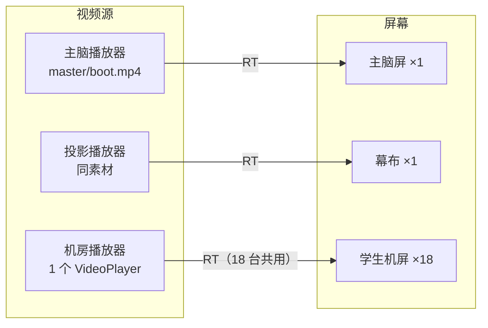
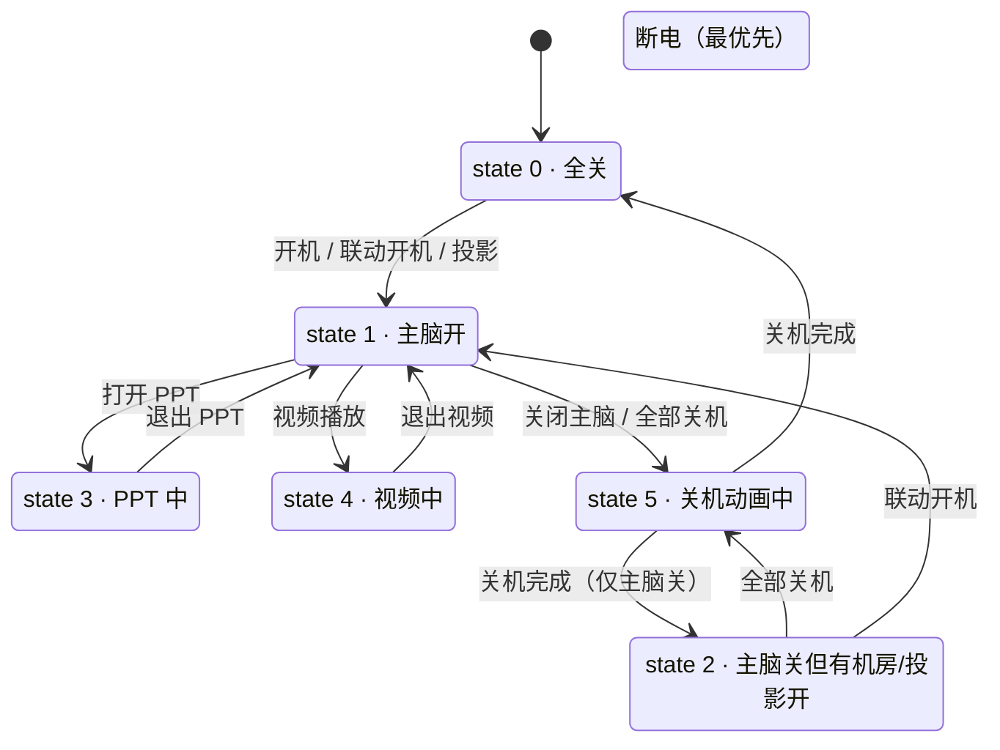
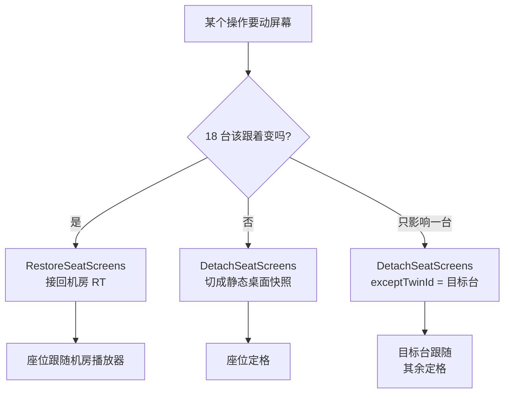
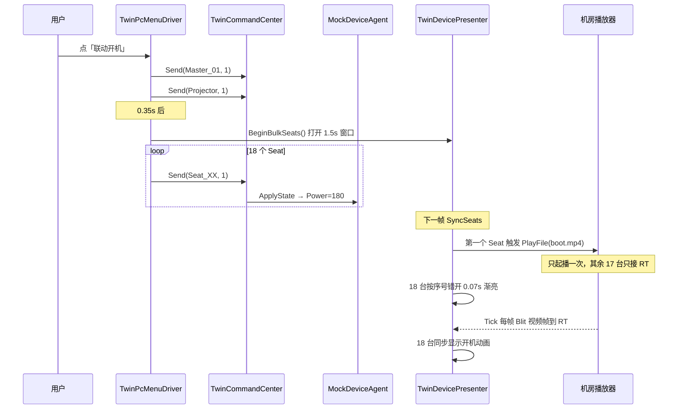
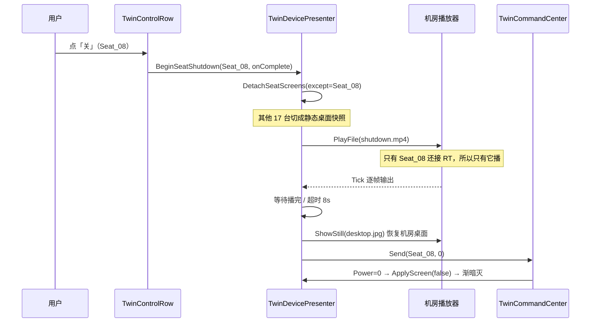

# 机房交互模块 · 技术实现汇报

> 作者：断点（unity-csharp-dev）  
> 时间：2026-11-02  
> 状态：全部交互 play 验证通过  
> 编译：`Assembly-CSharp.dll` 2026-11-02 11:26:28

---

## 一、模块定位

机房（1F 计算机教室）是项目里**交互最密集**的场景：1 个主脑 + 18 台学生机 + 1 台投影，共 20 块屏幕，需要支持

- 整间联动（联动开机 / 全部关机）
- 单台独立（面板开关任意一台）
- 演示模式（PPT / 视频只投主脑 + 幕布）
- 局部操作（只关主脑，18 台不动）

难点不在功能本身，而在**20 块屏只有 3 个视频源**，如何让"整间"和"单台"两种语义共存而不互相污染。

---

## 二、架构分层

```
┌─────────────────────────────────────────────────────────┐
│  交互入口层                                               │
│  TwinPcMenuDriver（走近主脑的菜单，6 态状态机）             │
│  TwinControlRow / TwinControlPanel（面板单台开关）         │
└───────────────────────┬─────────────────────────────────┘
                        │ 命令 / 调用
┌───────────────────────▼─────────────────────────────────┐
│  命令层                                                   │
│  TwinCommandCenter.TrySend(twinId, action, value)        │
│  → MockDeviceAgent.ApplyState（设备侧执行）               │
└───────────────────────┬─────────────────────────────────┘
                        │ 状态写入
┌───────────────────────▼─────────────────────────────────┐
│  数据层                                                   │
│  TwinAnchor.Values（当前值 + 上一个值）                   │
│  MockDataSource（波形 / override）                        │
└───────────────────────┬─────────────────────────────────┘
                        │ 轮询读取（0.1s）
┌───────────────────────▼─────────────────────────────────┐
│  表现层                                                   │
│  TwinDevicePresenter                                     │
│    ├─ _screens      主脑 / 18 个 Seat 的 ScreenVisual     │
│    ├─ _projectors   投影仪的 ProjectorVisual              │
│    └─ _roomPlayer   机房独立播放器（18 台共用一张 RT）     │
└─────────────────────────────────────────────────────────┘
```

**分层原则**：数据层只认"这台设备开没开"，表现层自己决定"这块屏该显示什么"。任何"整间"的语义都在表现层实现，不下沉到数据层。

---

## 三、设备与资源归属（这是所有逻辑的前提）

### 设备

| 角色       | TwinId                            | 数量            |
| -------- | --------------------------------- | ------------- |
| 主脑       | `ClassComputer/PC/Master_01`      | 1             |
| 学生机      | `ClassComputer/PC/Seat_01..18`    | 18            |
| 投影仪      | `ClassComputer/Projector/Main_01` | 1             |
| ~~机房聚合~~ | ~~`ClassComputer/PC/Room_01`~~    | **0（场景里不存在）** |

### 资源归属



**关键**：三个视频源完全独立。机房播放器不挂任何 Renderer，只负责产出 RT。

---

## 四、状态机（6 态）



**判定代码**：

```csharp
if (!TwinCircuit.IsPowered(MasterId)) → 断电（盖过一切）
else if (IsShuttingDown)              → state 5
else if (PlayMode == Ppt)             → state 3
else if (PlayMode == Video)           → state 4
else if (IsOn(MasterId))              → state 1
else if (AnySeatOn() || IsOn(Projector)) → state 2
else                                  → state 0
```

> `AnySeatOn()` 遍历 18 个 Seat 的 `Power`，**不是**读 `Room_01`（那个点位不存在，恒为 false）。

---

## 五、核心机制：Detach / Restore

这是整个模块的**唯一抽象**，也是踩坑最集中的地方。

### 概念

| 状态               | 含义       | 座位屏贴什么                 |
| ---------------- | -------- | ---------------------- |
| **接 RT**（默认）     | 跟着机房播放器走 | `_roomPlayer.ScreenRT` |
| **定格**（Detached） | 不跟着变     | `_seatSnapshot`（静态桌面图） |

### 决策图



### 配对表

| 调用点                                  | 方法                     | 原因            |
| ------------------------------------ | ---------------------- | ------------- |
| `ShutdownRoutine(includeRoom=false)` | `Detach`               | 只关主脑，座位不该跟着黑  |
| `ShutdownRoutine(includeRoom=true)`  | `Restore`              | 全部关机，座位要播关机动画 |
| `EnterPptMode`                       | `Detach`               | PPT 只投主脑+幕布   |
| `EnterVideoMode`                     | `Detach`               | 视频只放主脑+幕布     |
| `ExitPptMode`                        | `Restore`              | 恢复座位          |
| `ExitVideoMode`                      | `Restore`              | 恢复座位          |
| `BeginSeatShutdown`                  | `Detach(exceptTwinId)` | 只让目标台播关机动画    |

> **新增任何入口，先在这张表里选一边。** 选错就是新一轮"修好 A 弄坏 B"。

---

## 六、两条典型链路（时序）

### 1. 联动开机



**关键点**：

- `BeginBulkSeats()` 打开窗口 → 窗口内不互相摘除
- 只有第一个 Seat 调 `PlayFile`（`_bulkBootStarted` 防重复）
- 18 台共用一张 RT，所以是"一起播"，不是"各自播"

### 2. 单台关机



**关键点**：

- `exceptTwinId` 排除目标台 → 其他 17 台不跟着播
- 播完切回桌面图（不是切回 `boot.mp4`，否则又要 Prepare 1~2 秒）
- 有超时保护（8s）+ `Application.isPlaying` 检查，退出 Play 不会卡

---

## 七、关键设计决策与理由

| 决策                              | 理由                                         | 代价                         |
| ------------------------------- | ------------------------------------------ | -------------------------- |
| **机房用独立播放器**                    | 共用主脑 RT 会导致"主脑换片座位跟着变""主脑关了座位没画面"          | 多 1 路解码                    |
| **18 台共用一张 RT**                 | 18 个 `VideoPlayer` 会明显掉帧                   | 无法各自播不同内容（也不需要）            |
| **座位屏各自独立材质**                   | 单台可控必须独立材质                                 | 18 draw call，无法合批          |
| **批量窗口区分联动/单台**                 | 两种语义共用一张 RT，必须靠"谁起播"区分                     | 1.5 秒窗口，超时可能误判（实际不会）       |
| **Detach 用静态快照而非白遮罩**           | 白屏看起来像"坏了"，桌面图才像"开着但没在放"                   | 一次 `ReadPixels`（约 3MB 一次性） |
| **机房播放器常驻 `_on=true`**          | 关掉后下次 `SetOn(true)` 会重新 `Prepare`，黑屏 1~2 秒 | 常驻 1 路解码                   |
| **关机动画前先 `ShowStill(Desktop)`** | `PlayFile` 异步 Prepare，期间 RT 保持桌面，不黑屏       | 无                          |

---

## 八、性能数据（实测）

| 项         | 数值                                   |
| --------- | ------------------------------------ |
| 机房播放器     | 1 个 `VideoPlayer` + 1 张 RT（512 图集）   |
| 座位材质      | 18 份独立 `Material`（各带 `_EmissionMap`） |
| 快照内存      | 约 0.75 MB（512×512 RGB24）             |
| 采样开销（时序层） | 0.45 ms/s（占 CPU 0.045%）              |
| 内存（时序缓冲）  | 358 KB（149 个指标 × 300 点）              |


---

## 九、代码索引

| 文件                                       | 行数   | 关键方法                                                                                                                                                                          |
| ---------------------------------------- | ---- | ----------------------------------------------------------------------------------------------------------------------------------------------------------------------------- |
| `Scripts/Present/TwinDevicePresenter.cs` | 4735 | `BuildScreen`（Seat 分支）、`ApplyScreen`、`ShutdownRoutine`、`SeatShutdownRoutine`、`DetachSeatScreens`、`RestoreSeatScreens`、`RoomScreenPlayer`、`TickScreenVideos`、`ForceScreensOff` |
| `Scripts/Present/PcScreenPlayer.cs`      | 708  | `SetOn`、`PlayFile`、`ShowStill`、`Tick`、`IsOn`                                                                                                                                  |
| `Scripts/UI/TwinPcMenuDriver.cs`         | 476  | `BuildItems`（状态机）、`SendRoom`、`AnySeatOn`、`BeginBulkSeats` 调用                                                                                                                  |
| `Scripts/UI/TwinControlRow.cs`           | 522  | `Send` / `SendNow`（单台开关拦截）                                                                                                                                                    |
| `Scripts/UI/TwinControlPanel.cs`         | 2010 | `SendPower` / `SendPowerNow`                                                                                                                                                  |
| `Scripts/Command/MockDeviceAgent.cs`     | 773  | `ApplyState`、`PcUnitCount`、`SeedSeatAnchors`                                                                                                                                  |

**配套文档**：

- `Docs/机房交互逻辑总表.md`（355 行，10 节，含完整矩阵与检查清单）
- `Docs/机房交互_踩坑日志.md`（16 条坑，含根因与教训）

---

## 十、后续可优化项（未做）

| 项                | 说明                                                           | 优先级   |
| ---------------- | ------------------------------------------------------------ | ----- |
| `Room_01` 残留代码清理 | `MergeUnits` / `SyncUnitsEmissionMap` 里还有 `Room_01` 分支，永远走不到 | 低     |
| 18 台开机动画的"各自节奏"  | 现在是一起播同一段；要各自播需 18 个播放器                                      | 低（掉帧） |
| 座位快照缓存           | 每次 Detach 都重新 `ReadPixels`，可以只在桌面图变化时重拍                      | 低     |
| 关机动画的"逐个熄灭"      | 现在是同时渐暗；逐个灭需要每台独立 stagger                                    | 中     |
